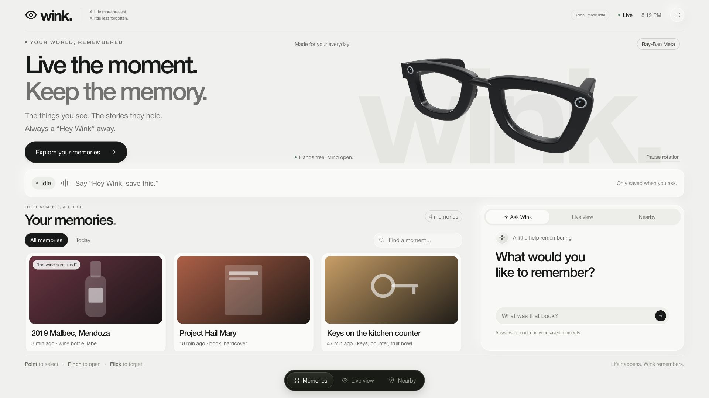
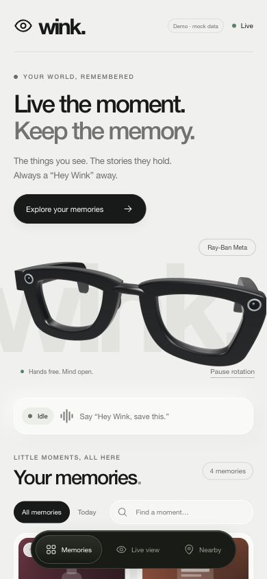
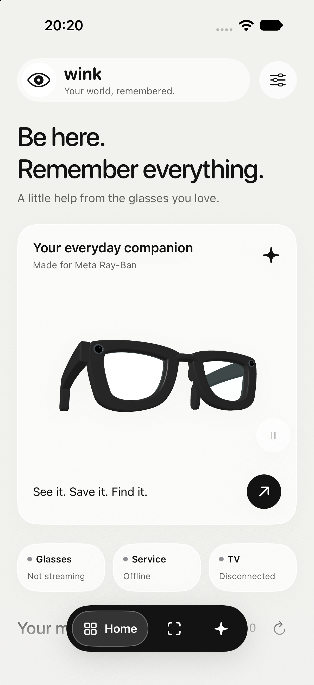

# PR4: Wink UI redesign

The TV dashboard and native iOS app share a soft off-white palette, rounded cards, black navigation dock, and an original smart-glasses model inspired by the supplied Wayfarer reference. The screens keep Wink’s memory, capture, and recall workflows.

## Behavior

- TV: responsive 720p/1080p composition, searchable memories with All/Today filters, typed questions through `/v1/ask`, and keyboard-accessible Ask/Live/Nearby tabs. Existing live events, privacy pause, reconnect, memory details and gestures remain wired up. Filtering clears stale gesture selection before a flick can delete a hidden memory.
- iOS: Home, Capture and Ask tabs; searchable memory cards/details; confirmed deletion with retryable errors; existing camera/glasses, gesture, push-to-talk, privacy and TV controls. Settings and service configuration remain available.
- Glasses: local GLB rendered with Three.js on web, identical DAE geometry rendered by SceneKit on iOS. Automatic rotation can be paused and respects reduced-motion settings; rendering pauses in the background. Web supports mouse dragging and an SVG fallback. These are original illustrative assets, not official manufacturer geometry. See [asset provenance and regeneration](../../backend/public/tv/models/ASSETS.md).

## Validation

- `cd backend && npm run check`: typecheck + 72 tests passed, including 12 TV tests.
- `npm run build`: Worker production bundle dry run passed; no deployment.
- `WINK_BASE_URL=http://127.0.0.1:8788 npm run smoke`: local MOCK HTTP/WebSocket save/list/image/ask/nearby/delete and privacy-related relay checks passed.
- `npm run build:glasses`: model and local viewer generation passed.
- Browser: 1280×720 and 1920×1080 TV layouts, 390×844 mobile web layout, question response, search, tabs and rotation checked.
- Native iOS: full simulator workspace build with WhisperKit, Meta DAT and MediaPipe passed; all 9 existing unit tests passed. Xcode project regenerated using XcodeGen and CocoaPods. Signing team and bundle identifier unchanged.
- Native screenshot below uses the actual built app with its existing test startup guard, so camera/microphone services and saved API configuration were not touched. Physical glasses, Bluetooth audio and device performance still need device testing.

The user explicitly requested both TV and mobile UI changes. Backend API contracts and provider services are unchanged. Cloud deployment stays with Arboy.

## Screenshots

TV, 1920×1080 (MOCK data):

Mobile web, 390×844 (MOCK data):

Native iOS, actual simulator app with service startup skipped:

